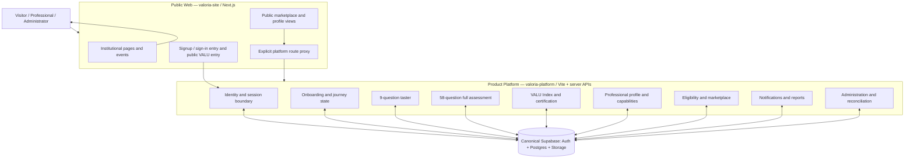
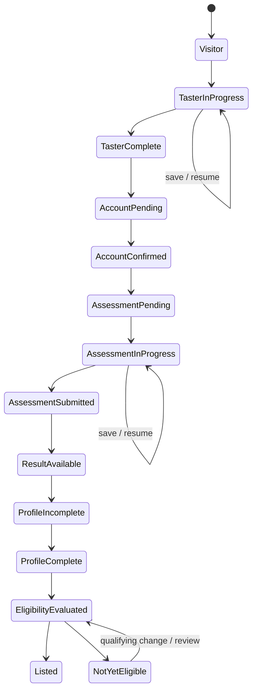

# Valoria Institute — Target System Design

**Document ID:** VI-SD-2026-001  
**Repository:** `riverwayse-sudo/valoria-site`  
**Application role:** Institutional web experience and public entry layer  
**Status:** Proposed target architecture; validate against implementation before refactoring.

## 1. Architectural objective

Valoria is one product delivered through two separately deployable applications and one canonical data platform. The separation is intentional; duplicated business logic is not.

- The public site owns institutional content, public discovery and the browser-facing entry experience.
- The platform owns authenticated product workflows and all authoritative business rules.
- Supabase is the canonical identity and persistence layer shared by the applications.
- APIs are the explicit boundary between the site and platform. Browser routes, proxy rewrites and hosting configuration are transport—not business logic.

The system must preserve user identity, taster answers, full-assessment answers, official scores, reports, professional profiles and marketplace records during all changes.

## 2. Logical architecture

The diagram is a logical ownership view, not a claim that every domain is already implemented as a separate deployable service. Keep the platform as a modular application until scale or operational evidence justifies service extraction.

## 3. Application boundaries

### A. Public web — this repository

Owns:
- Institutional homepage, about, programmes, PRIME explanation, contact, legal and event presentation.
- Public marketplace discovery and public professional profile rendering.
- Public conversion entry points and the visual experience around account creation.
- Responsive layout, accessibility, metadata, SEO and approved brand system.
- A narrow, explicit proxy for platform-owned routes where a unified public URL is required.

Must not own:
- Password verification, account identity, authoritative session validation.
- Taster/full assessment answers, completion state or scoring formulas.
- VALU Index, merit-tier or certification decisions.
- Professional profile persistence, marketplace eligibility or listing decisions.
- Duplicated journey-state calculations or privileged database writes.

### B. Product platform — `riverwayse-sudo/valoria-platform/valoria-final`

Owns:
- Authenticated onboarding, taster and full-assessment workflows.
- Assessment persistence, resume, submission and idempotency.
- Canonical scoring, VALU Index, reports and certification rules.
- Journey state and allowed state transitions.
- Professional profiles, capability records, eligibility and listing state.
- Notifications, administrative operations, reconciliation and audit trails.

The current platform is a Vite application with server-side API handlers. Do not treat client-side route guards as authorization. Every protected API must verify the authenticated identity and authorization server-side.

### C. Canonical data platform

Supabase owns the canonical account identity and durable product records. Both applications must use the same intended project/environment pairing for a given environment. Preview must never silently write to production.

Do not invent or rename database tables during this architecture phase. First inventory actual migrations, RPCs, RLS policies, constraints and data dependencies. Existing participant records must be preserved.

## 4. Domain ownership and authoritative records

| Domain | Authority | Consumers |
|---|---|---|
| Identity and session | Platform auth boundary + Supabase Auth | Site entry, platform, protected APIs |
| Taster | Platform taster lifecycle | Dashboard, full assessment handoff |
| Full assessment | Platform assessment lifecycle | Scoring, journey, profile |
| Scoring/certification | Platform scoring domain | Reports, dashboard, profile |
| Journey | Platform journey state machine | Dashboard and notifications |
| Professional profile | Platform profile domain | Public site and marketplace |
| Capability | Platform profile/capability domain | Marketplace discovery |
| Eligibility/listing | Platform marketplace domain | Public marketplace |
| Institutional content | Site content layer | Public visitors |
| Event presentation | Site; registration persistence owned by platform/API where authenticated | Visitors and professionals |
| Communications | Platform delivery service | Site/platform user journeys |
| Administration | Platform privileged APIs | Authorized administrators |

No consumer may independently recalculate an authoritative domain decision.

## 5. Canonical user journey

1. Visitor opens the institutional site and chooses **Create account** or **Sign in**. Signup/sign-in is a concise modal or entry surface, not a complicated pre-assessment funnel.
2. New users create an account, confirm their email and arrive at the dashboard with a valid authenticated session; no second sign-in should be required. Existing users sign in and resume their persisted journey.
3. Dashboard reads canonical journey state and clearly presents the next action. The full VALU journey is the priority; the interface must not create competing assessment prompts.
4. The authenticated user starts or resumes the **9-question directional taster**. Its result is introductory only and is not the official VALU Index.
5. Taster answers and identity linkage persist. The user can leave, return and resume without losing answers.
6. The user proceeds to the **58-question full assessment** according to the canonical assessment version and transition rules. The UI must not guess whether the taster is counted inside the 58; that relationship must be explicit in the versioned assessment contract.
7. Answers persist incrementally; resume returns the next unanswered question without losing saved answers.
8. Submission is idempotent and produces one authoritative assessment result.
9. Scoring creates the official VALU Index and PRIME point results; reports and merit/certification decisions use that result.
10. Profile setup is a distinct workflow. It must not erase, reset or block assessment progress; dashboard prioritises assessment continuation until completion.
11. Profile capability summaries are derived from authoritative assessment/report data, not a free-text bio.
12. Marketplace eligibility and public listing are separate decisions. Completing an assessment must not be conflated with meeting a listing threshold. A score threshold such as 35 points must not block assessment completion.
13. Marketplace exposes one professional identity with one or more capabilities (Talent, Speaker, Facilitator), subject to the canonical eligibility/listing rules.

## 6. Journey state machine

Use explicit persisted states and validated transitions. Suggested conceptual states (map to actual schema only after inventory):

This is a target conceptual lifecycle, not a mandate to replace existing statuses wholesale. Build an explicit mapping from current persisted values before any migration.

Rules:
- Authentication state, assessment state, profile completeness and marketplace listing are distinct dimensions.
- Never infer assessment completion from a dashboard percentage, profile flag or marketplace record.
- Never infer listing eligibility from assessment completion alone.
- Preserve resumability and idempotency across refresh, session renewal and email confirmation.
- Failed email delivery must not silently destroy account or assessment progress.

## 7. API and integration contracts

All cross-application requests must have a documented contract:
- Method and canonical path.
- Request and response schema with versioning strategy.
- Authentication and authorization requirements.
- Idempotency behaviour for writes/submissions.
- Error envelope and stable machine-readable error code.
- Timeout/retry policy and whether retries are safe.
- Data owner and source of truth.
- Contract tests and end-to-end acceptance tests.

The current assessment proxy is a priority contract to repair. Establish a single route map for:
- Assessment HTML entry and nested JS/CSS/static assets.
- Taster progress read/write.
- Taster submission.
- Full-assessment progress read/write.
- Full-assessment submission.
- Taster-to-assessment identity linking.
- Report generation/delivery.

Do not use a broad `/api/*` proxy: site-owned API routes must remain local unless explicitly listed. Do not let the Vite SPA fallback consume API requests or static assets.

## 8. Data integrity and security

- Use stable Auth user IDs as identity keys; validate UUIDs before database/RPC calls.
- Enforce ownership and role checks server-side; never trust editable user metadata for authorization.
- Use least-privilege Supabase policies and narrowly scoped server credentials.
- Never expose service-role secrets to browser bundles, logs or committed files.
- Keep environment pairing explicit: local ↔ local/test data, preview ↔ isolated preview data, production ↔ production.
- Use database constraints and transactions for identity linking, assessment submission and listing uniqueness where supported by the existing model.
- Record audit events for privileged reconciliation and eligibility overrides.
- Minimise personal data in public profile payloads; never expose private email addresses.
- Preserve existing user records and historical assessment evidence. Reconciliation must be evidence-based and reversible.

## 9. Reliability and observability

Every important journey transition should be diagnosable by a correlation/request ID and safe event record. Track:
- Signup initiated / account created / email confirmed / session established.
- Taster started / answer saved / submitted.
- Full assessment resumed / answer saved / submitted.
- Result generated / report delivered.
- Profile saved / capability updated.
- Eligibility evaluated / listing published or withheld.
- API/proxy failures, authorization failures, latency and retry outcomes.

Logs must not contain passwords, access tokens, service keys or unnecessary answer payloads. Distinguish user-facing failure from infrastructure failure.

## 10. Deployment topology and release controls

- Keep the public Next.js site and Vite/serverless platform separately buildable and deployable.
- Use explicit per-environment upstream origins and prevent preview-to-production fallthrough.
- Test the upstream platform directly and through the public-site proxy.
- Validate actual loaded JS/CSS assets, API methods, auth cookies/session propagation and CORS—not just HTML 200 or build success.
- Run module tests, API contract tests, cross-app integration tests and full user-journey acceptance tests before release.
- Production promotion requires a known-good commit, successful checks, staging acceptance, rollback plan and post-release smoke tests.
- Do not deploy as part of documentation or architecture work.

## 11. Regression prevention

Every defect receives a module ID and a regression test that reproduces the original failure. Required gates:
1. Unit tests for domain rules.
2. API contract tests for each endpoint.
3. Database/RLS/migration tests for persistence and authorization.
4. Integration tests for site ↔ platform ↔ Supabase.
5. Browser acceptance tests for complete journeys at desktop and mobile sizes.
6. Production smoke checks after a controlled release.

A module is not VERIFIED because its code compiles. It is verified only when its acceptance criteria pass in the intended environment.

## 12. Architecture decisions to ratify during implementation

- Keep two applications; do not merge repositories or split into microservices without evidence.
- Keep platform business rules and durable workflows out of the public site.
- Use one canonical Supabase data authority per environment.
- Keep API contracts explicit and versionable.
- Keep assessment completion independent of marketplace eligibility/listing.
- Keep profile identity singular, with multiple capabilities.
- Keep the taster directional and the official VALU Index tied to the authoritative assessment.
- Treat deployment/runtime routing as part of the product architecture and test it end-to-end.

## 13. Immediate architecture validation backlog

1. Inventory actual platform root and deployment root (application is currently under `valoria-final/`).
2. Trace all site rewrites and platform Vercel rewrites against real built asset paths and API handlers.
3. Establish which host is authoritative for the platform runtime in each environment; do not mix Cloudflare and Vercel assumptions.
4. Inventory Supabase Auth configuration, migrations, RPCs, RLS and environment variables without exposing secret values.
5. Map current journey status fields and transitions to the target state model.
6. Map canonical assessment, scoring, profile, capability and listing records without altering data.
7. Create contract and end-to-end regression coverage before changing the implementation.
